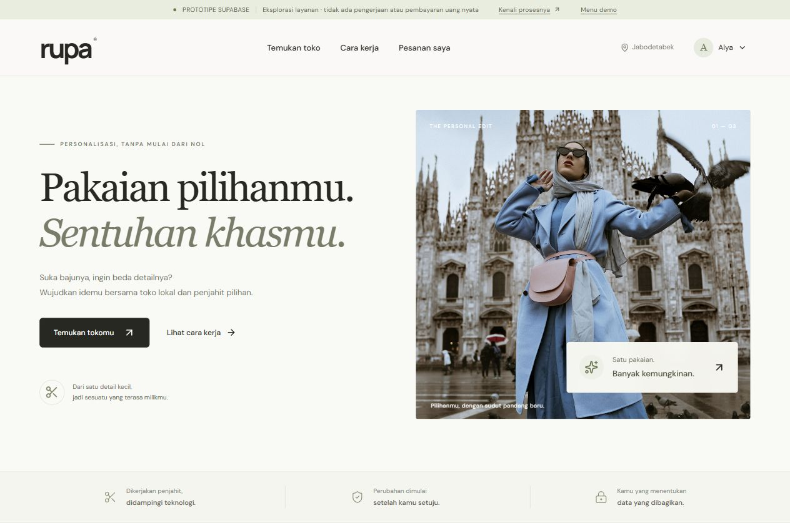
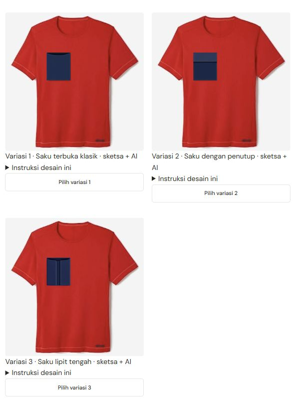

# Rupa — Clothing Customization Studio

A web prototype connecting customers, Indonesian fashion stores, and tailors. Customers verify a clothing purchase, describe the changes they want, compare illustrative AI designs, and discuss feasibility with an assigned tailor before approving a quote.



## Main features

- Partner-store discovery and purchase verification by the store owner.
- Role-based workspaces for customers, stores, tailors, and administrators.
- Numbered design markers and structured pocket controls for shape, color, position, and visual size.
- Three guided pocket alternatives: classic open, flap, and center pleat.
- Current/target garment measurements and optional AI assistance for consultation.
- Private customer–tailor consultation, versioned quotes, payment sandbox, inspection, work approval, QC, delivery tracking, and warranty requests.
- Store administration and assignment of tailors to specific stores.



The previews above were generated by the actual local prototype. Pocket outlines are supplied by a geometric sketch, then processed by SDXL. Their texture remains illustrative; these are not photographs of completed tailoring work or fit guarantees.

## Stack

Next.js, React, TypeScript, Supabase Auth/Postgres/private Storage, and a separate Python FastAPI inference worker. The active image path uses SDXL Inpainting; ControlNet supports free-form editing, while structured pockets disable its conditioning influence. Qwen provides optional language/measurement assistance. The retired cGAN experiment is archived as source code in `archive/cgan`.

## Run the web app

Requires Node.js 24+ and pnpm.

```powershell
pnpm install
Copy-Item .env.example .env.local
pnpm dev
```

Open http://127.0.0.1:3050. The default example configuration is a local demo with synthetic data. For a production-style local build:

```powershell
pnpm build
pnpm start
```

Or run `./start-rupa.ps1` after installing dependencies. The build uses webpack because the Windows Turbopack tracer previously tried to read the large Python model files.

## Configure your own Supabase project

Set `APP_MODE=supabase` and the Supabase variables listed in `.env.example`. Run `supabase/schema.sql` in your own project's SQL editor, configure the private `rupa-private` Storage bucket as specified there, and inspect the seed script before running `pnpm setup:seed` against your own project. The repository does not include a database export, customer photos, live credentials, or access to the original development project's data.

The optional four-role demo menu is restricted to localhost. Demo credentials in the source are for synthetic local testing and must not be used for real customer accounts. Keep `.env.local` private.

## Optional AI worker

The web forms and tailor consultation work without local image models. Image generation requires reinstalling the Python inference environment and separately downloading pretrained weights. See [AI worker setup](ai-worker/README.md) and [pocket editor details](ai-worker/POCKET_EDITOR.md).

Model weights, GAN checkpoints, training datasets, Python environments, Node dependencies, and build outputs are deliberately excluded from Git. The development laptop's bulky inference files were removed to reclaim disk space. Clone/install does not silently download AI weights.

## Validation

```powershell
pnpm test
pnpm typecheck
pnpm build
```

For the optional worker, from `ai-worker` with its environment installed:

```powershell
.\.venv-local\Scripts\python.exe -m unittest test_sdxl test_edit_mask test_pocket_layout
```

The latest design-variant checks passed 39 application tests and 18 worker tests. A real three-image run showed the open/flap/pleated alternatives and confirmed unchanged pixels outside the allowed edit mask. This is one tested garment, not a general accuracy benchmark.

## Prototype limits

- Store partnerships, physical garment handling, shipping and demo payments are illustrative.
- Midtrans is an optional sandbox integration; this is not a live production payment deployment.
- Chat polls for updates. AI jobs use Next.js `after()` and are not a durable background queue.
- Tailors must inspect material, seam allowance, measurements and workmanship before accepting a change.
- Body measurements are not inferred automatically from height or weight.
- Catalogue retrieval and the cGAN experiment are retired from the active customer flow.

Additional actual screenshots are in `docs/screenshots`. No model binaries or customer data are needed to browse the source.
